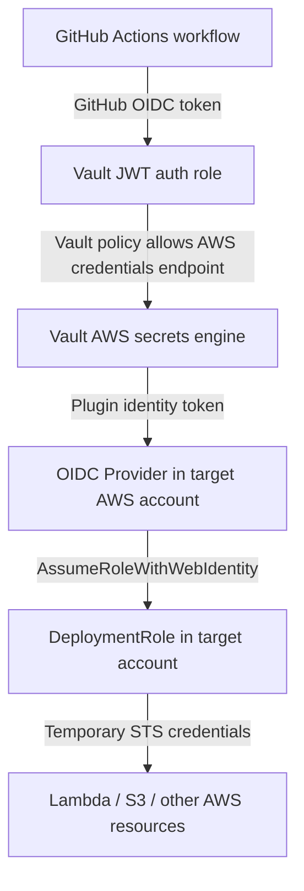
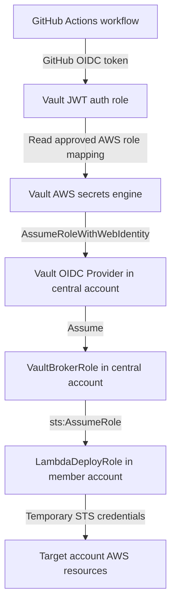
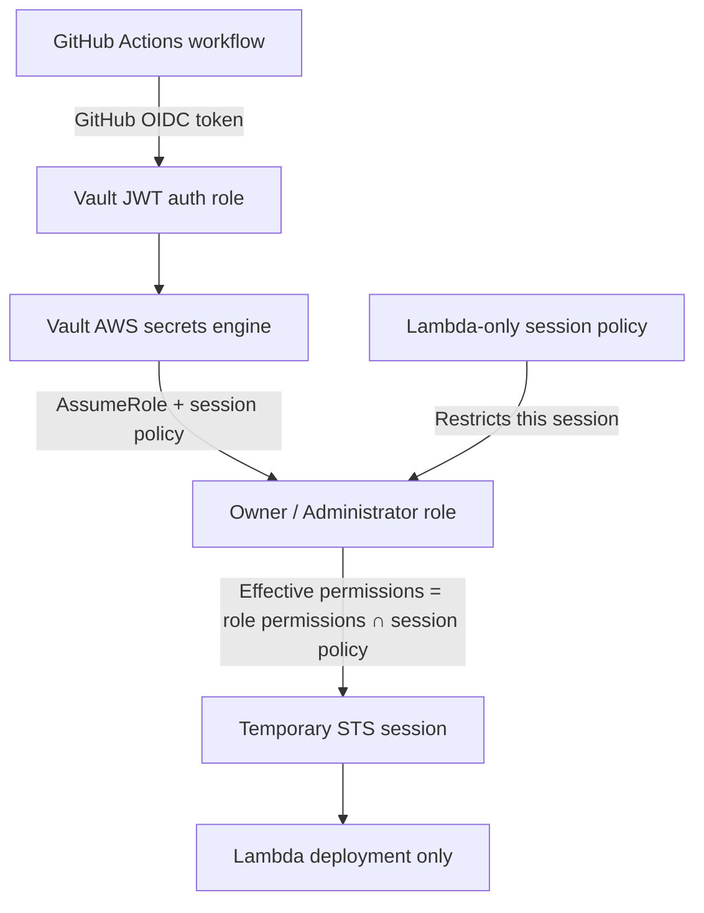

# AWS access through HashiCorp Vault

## Proof of concept

Successful GitHub Actions run:

- [AWS Vault OIDC S3 smoke test #33012137896](https://github.com/wonchoe/cei-test/actions/runs/33012137896)
- Repository: `wonchoe/cei-test`
- Branch: `oleksii/test`
- Workflow: `.github/workflows/aws-vault-s3.yml`

The workflow successfully completed this chain:

```text
GitHub Actions OIDC
        -> Vault JWT authentication
        -> Vault AWS secrets engine
        -> AWS STS temporary credentials
        -> aws sts get-caller-identity
        -> aws s3 ls
```

No long-lived AWS access key was stored in GitHub Actions.

## Three access patterns

### 1. Direct Vault OIDC into each AWS account

Each AWS account has its own IAM OIDC provider and deployment role. This is simple to understand, but the provider and role must be bootstrapped in every account.



### 2. Central broker account

The OIDC provider exists once in a central tooling or security account. Member accounts contain standard deployment roles that trust the central broker role.



New member accounts can receive `LambdaDeployRole`, `S3DeployRole`, and similar roles automatically through Control Tower or CloudFormation StackSets.

### 3. Owner/Admin role restricted by session policy

An existing Owner or Administrator role can be assumed with an inline session policy. The effective permissions are the intersection of the role policy and the session policy.



This pattern can work for a proof of concept and avoids changing shared role policies during concurrent deployments. The workflow can use a fail-closed design: validate the returned AWS role and deployment context before running any deployment command, and stop with a non-zero status if validation fails. AWS does not automatically reject `AssumeRole` when a session policy is omitted, so Vault must generate and apply the session policy consistently. Dedicated deployment roles still provide clearer auditing and a smaller permission scope.

## Current test configuration

### AWS account

```text
Account: 468185235976
```

### AWS OIDC provider

The provider was created in the AWS account above:

```text
arn:aws:iam::468185235976:oidc-provider/vault.cursor.style/v1/admin/identity/oidc/plugins
```

Provider URL:

```text
https://vault.cursor.style/v1/admin/identity/oidc/plugins
```

Audience:

```text
vault.cursor.style/v1/admin/identity/oidc/plugins
```

AWS IAM OIDC providers are account-scoped resources. They are not IAM users, IAM roles, or Organization-level resources.

The `vault.cursor.style` endpoint is served through the Kubernetes Traefik setup. A temporary proxy forwards the Vault plugin discovery and JWKS paths to the HCP Vault Dedicated cluster. AWS requires the OIDC provider URL to use HTTPS without port `8200`.

### AWS role

```text
Role name: VaultOneRoleNoSelfTrust
ARN: arn:aws:iam::468185235976:role/VaultOneRoleNoSelfTrust
```

Despite the historical test name, the final working role contains a self-assume statement because the Vault AWS `assumed_role` flow performs a second `sts:AssumeRole` request on a fresh mount.

### Why does the role trust itself?

Yes, this test role is explicitly allowed to assume itself. This is intentional for the one-role experiment, but it is not a general AWS requirement.

The flow has two AWS steps:

```text
1. Vault uses its plugin identity token to enter VaultOneRole.
2. The Vault AWS secrets engine calls sts:AssumeRole on VaultOneRole to issue a fresh lease.
```

AWS evaluates the second request independently. The role therefore needs both:

```text
Trust policy: Principal VaultOneRole may call sts:AssumeRole
Permissions policy: VaultOneRole may call sts:AssumeRole on its own ARN
```

Each workflow still receives its own temporary STS session, so concurrent runs do not modify the role or its policies. The self-trust is only a technical requirement of this one-role `assumed_role` arrangement.

The central broker design does not use self-trust:

```text
Vault OIDC → VaultBrokerRole → target DeploymentRole
```

In that design, the target role trusts `VaultBrokerRole`, and the broker role is allowed to assume the target role.

The role currently has these inline policies:

```text
AllowS3ListForPoc
AllowSelfAssume
```

Effective test permissions are intentionally limited to:

```json
{
  "Version": "2012-10-17",
  "Statement": [
    {
      "Effect": "Allow",
      "Action": [
        "s3:ListAllMyBuckets",
        "s3:GetBucketLocation"
      ],
      "Resource": "*"
    }
  ]
}
```

The role does not retain the broad AWS-managed `ReadOnlyAccess` policy.

### AWS role trust policy

The role trusts the Vault OIDC provider and restricts both the audience and the Vault AWS secrets-engine mount:

```json
{
  "Version": "2012-10-17",
  "Statement": [
    {
      "Effect": "Allow",
      "Principal": {
        "Federated": "arn:aws:iam::468185235976:oidc-provider/vault.cursor.style/v1/admin/identity/oidc/plugins"
      },
      "Action": "sts:AssumeRoleWithWebIdentity",
      "Condition": {
        "StringEquals": {
          "vault.cursor.style/v1/admin/identity/oidc/plugins:aud": "vault.cursor.style/v1/admin/identity/oidc/plugins"
        },
        "StringLike": {
          "vault.cursor.style/v1/admin/identity/oidc/plugins:sub": "plugin-identity:*:secret:aws_c865bb8d"
        }
      }
    },
    {
      "Effect": "Allow",
      "Principal": {
        "AWS": "arn:aws:iam::468185235976:role/VaultOneRoleNoSelfTrust"
      },
      "Action": "sts:AssumeRole"
    }
  ]
}
```

The `sub` value identifies the Vault plugin identity and the AWS secrets-engine mount. The wildcard for the identity-key accessor is acceptable for this POC, but should be replaced with an exact value for production.

## Vault configuration

The AWS secrets engine is mounted twice for isolation during testing:

```text
aws/
aws-one/
```

The successful workflow uses the isolated `aws-one/` mount.

### Vault AWS configuration

The `aws-one/` mount is configured to use Vault Plugin Workload Identity Federation:

```text
identity_token_audience=vault.cursor.style/v1/admin/identity/oidc/plugins
role_arn=arn:aws:iam::468185235976:role/VaultOneRoleNoSelfTrust
```

### Vault AWS role mapping

```text
Vault path: aws-one/roles/aws-one-role
credential_type: assumed_role
role_arns: arn:aws:iam::468185235976:role/VaultOneRoleNoSelfTrust
default_sts_ttl: 15m
max_sts_ttl: 1h
```

When a client reads:

```text
aws-one/creds/aws-one-role
```

Vault returns temporary AWS STS credentials. These credentials include an access key, secret key, session token, and lease metadata. The lease is revoked automatically at expiration and can also be revoked manually.

### GitHub-to-Vault authentication

The GitHub workflow receives an OIDC token from GitHub Actions. Vault validates it through the `jwt/` auth method.

The Vault JWT role used by the workflow is:

```text
github-aws-s3-test
```

It is restricted to:

```text
repository: wonchoe/cei-test
ref: refs/heads/oleksii/test
workflow_ref: wonchoe/cei-test/.github/workflows/aws-vault-s3.yml@refs/heads/oleksii/test
audience: https://github.com/wonchoe
```

Its Vault policy allows only:

```hcl
path "aws-one/creds/aws-one-role" {
  capabilities = ["read"]
}
```

Therefore, the GitHub repository does not receive a general Vault admin token. It receives a short-lived Vault token restricted to one AWS credentials endpoint.

## Workflow example

The important part of `.github/workflows/aws-vault-s3.yml` is:

```yaml
permissions:
  contents: read
  id-token: write

steps:
  - name: Read temporary AWS credentials from Vault
    uses: hashicorp/vault-action@v2
    with:
      url: https://vault-cluster-public-vault-961ebe1a.5e41c3d0.z1.hashicorp.cloud:8200
      namespace: admin
      method: jwt
      path: jwt
      role: github-aws-s3-test
      jwtGithubAudience: https://github.com/wonchoe
      secrets: |
        aws-one/creds/aws-one-role access_key | AWS_ACCESS_KEY_ID ;
        aws-one/creds/aws-one-role secret_key | AWS_SECRET_ACCESS_KEY ;
        aws-one/creds/aws-one-role session_token | AWS_SESSION_TOKEN ;

  - name: Verify AWS identity
    run: aws sts get-caller-identity

  - name: List S3 buckets
    run: aws s3 ls
```

The semicolon at the end of each `secrets` entry is required by `hashicorp/vault-action` when multiple secret fields are requested.

## Central account design

For multiple AWS accounts, the preferred model is to keep the Vault OIDC provider in one central tooling/security account.

```text
Vault
  -> OIDC provider in central account
  -> VaultBrokerRole in central account
  -> target deployment role in member account
  -> AWS resources
```

The central account is not an AWS Organization-level IAM scope. It is a normal AWS account selected to host shared access infrastructure.

### Central broker role

The central `VaultBrokerRole` should have only the ability to assume approved target roles:

```json
{
  "Version": "2012-10-17",
  "Statement": [
    {
      "Effect": "Allow",
      "Action": "sts:AssumeRole",
      "Resource": [
        "arn:aws:iam::<MEMBER_ACCOUNT_ID>:role/LambdaDeployRole",
        "arn:aws:iam::<MEMBER_ACCOUNT_ID>:role/S3DeployRole"
      ]
    }
  ]
}
```

### Target role trust policy

Each member account can receive a standard role through Control Tower or CloudFormation StackSets:

```json
{
  "Version": "2012-10-17",
  "Statement": [
    {
      "Effect": "Allow",
      "Principal": {
        "AWS": "arn:aws:iam::<CENTRAL_ACCOUNT_ID>:role/VaultBrokerRole"
      },
      "Action": "sts:AssumeRole"
    }
  ]
}
```

The target role contains the real deployment permissions, for example only Lambda actions:

```json
{
  "Version": "2012-10-17",
  "Statement": [
    {
      "Effect": "Allow",
      "Action": [
        "lambda:CreateFunction",
        "lambda:UpdateFunctionCode",
        "lambda:UpdateFunctionConfiguration",
        "lambda:GetFunction",
        "lambda:PublishVersion"
      ],
      "Resource": "arn:aws:lambda:<REGION>:<MEMBER_ACCOUNT_ID>:function/<FUNCTION_NAME>"
    }
  ]
}
```

New accounts can receive the same role automatically when they enter a Control Tower organizational unit. CloudFormation can use `${AWS::AccountId}` to build account-specific ARNs.

## Owner/Admin role with a session policy

It is technically possible to keep an existing `Owner` or `AdministratorAccess` role and restrict a particular session with an inline session policy:

```text
VaultBrokerRole
  -> AssumeRole on OwnerRole
  -> session policy limits this specific session to Lambda actions
```

Example target trust policy:

```json
{
  "Version": "2012-10-17",
  "Statement": [
    {
      "Effect": "Allow",
      "Principal": {
        "AWS": "arn:aws:iam::<CENTRAL_ACCOUNT_ID>:role/VaultBrokerRole"
      },
      "Action": "sts:AssumeRole"
    }
  ]
}
```

Example session policy passed to `AssumeRole`:

```json
{
  "Version": "2012-10-17",
  "Statement": [
    {
      "Effect": "Allow",
      "Action": [
        "lambda:CreateFunction",
        "lambda:UpdateFunctionCode",
        "lambda:UpdateFunctionConfiguration",
        "lambda:GetFunction",
        "lambda:PublishVersion"
      ],
      "Resource": "arn:aws:lambda:<REGION>:<ACCOUNT_ID>:function/<FUNCTION_NAME>"
    }
  ]
}
```

The effective permissions are the intersection of the role permissions and the session policy:

```text
effective permissions = OwnerRole permissions ∩ session policy
```

The session policy cannot grant permissions that the role does not already have.

This approach avoids changing a shared role during every deployment and is safe for concurrent sessions. Each workflow receives a separate STS session. The workflow should validate the returned role and stop before deployment if the expected context is not present. Dedicated deployment roles remain preferable for clearer auditing and a smaller permission scope.

Recommended production order:

1. Dedicated capability roles such as `LambdaDeployRole`, `S3DeployRole`, and `ECSDeployRole`.
2. Automatic role bootstrap through Control Tower/StackSets.
3. Vault policies that map each repository and workflow to only the allowed capability role and account.
4. Owner/Admin plus session policies only as a controlled fallback.

## Security notes

- Keep the GitHub OIDC claims restricted by repository, branch, and workflow path.
- Keep Vault policies restricted to the exact AWS credentials endpoint.
- Keep AWS trust policies restricted by `aud` and `sub`.
- Replace the test wildcard in the Vault plugin `sub` with an exact identity-key accessor before production.
- Do not use a personal IAM user as the permanent Vault AWS configuration credential.
- Do not use AWS account root credentials.
- Use short STS TTLs and revoke leases after failed or cancelled deployments where possible.
- Do not rely on an Owner/Admin role as the primary deployment role.
