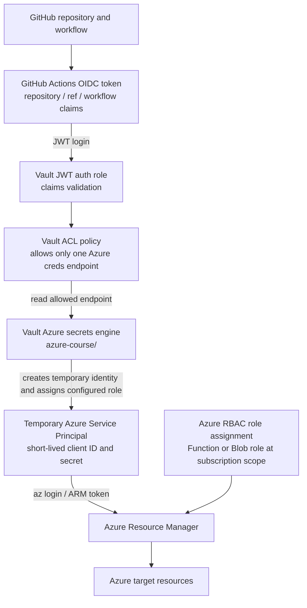
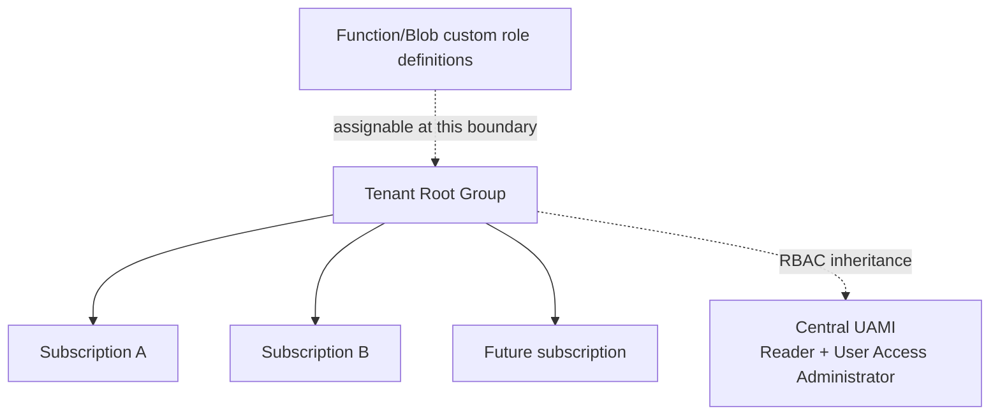

# Azure access through HashiCorp Vault

## Proof of concept

This repository contains two GitHub Actions workflows that demonstrate narrowly scoped Azure access through Vault:

- [Azure Function access through Vault](https://github.com/wonchoe/cei-test/actions/workflows/azure-function-vault.yml)
- [Azure Blob access through Vault](https://github.com/wonchoe/cei-test/actions/workflows/azure-blob-vault.yml)

Successful detailed runs:

- [Function workflow run 33106258092](https://github.com/wonchoe/cei-test/actions/runs/33106258092)
- [Blob workflow run 33106260288](https://github.com/wonchoe/cei-test/actions/runs/33106260288)

The workflows do not create or modify an Azure Function App or Storage Account. They call Azure Resource Manager with a deliberately nonexistent resource name and use the response to prove authorization:

- `404` means the identity is authorized for that resource provider, but the probe resource does not exist.
- `403` means the identity is not authorized for that resource provider.

## The complete chain



The human who clicks **Run workflow** is not represented as an Azure user in this design. Azure authorizes the GitHub workflow's temporary identity. The GitHub OIDC claims are the trust boundary used by Vault to decide whether that workflow may receive credentials.

## What is configured in Vault

The Vault cluster is accessed through:

```text
Endpoint: https://vault-cluster-public-vault-961ebe1a.5e41c3d0.z1.hashicorp.cloud:8200
Namespace: admin
JWT mount: jwt/
Azure secrets mount: azure-course/
```

### Vault Azure roles

The Azure secrets engine roles define what Vault requests from Azure and at which scope:

| Vault role | Azure custom role | Scope | Vault ACL policy |
| --- | --- | --- | --- |
| `function-publisher` | `VaultCourseFunctionPublisher` | `github-test` subscription | `github-azure-function` |
| `blob-deployer` | `VaultCourseBlobDeployer` | `github-test` subscription | `github-azure-blob` |

The Azure custom role definitions are assignable from the Management Group, but the current Vault role entries contain an explicit subscription scope. This is intentional for the POC: each target subscription gets its own Vault role or an approved onboarding update.

When the workflow reads `azure-course/creds/function-publisher` or `azure-course/creds/blob-deployer`, Vault uses the configured UAMI-backed Azure authentication, creates a temporary Service Principal, assigns the configured Azure role, and returns a short-lived `client_id` and `client_secret`. The workflow never stores a long-lived Azure secret.

### Vault JWT roles

The JWT roles restrict which workflow may request the credentials:

```text
repository       = wonchoe/cei-test
ref              = refs/heads/oleksii/test
audience         = https://github.com/wonchoe
job_workflow_ref = the exact approved workflow file and branch
```

The Function workflow uses `github-azure-function`; the Blob workflow uses `github-azure-blob`. Each role points to a different Vault ACL policy, so the Function workflow cannot read the Blob credentials endpoint and vice versa.

## Function workflow: allowed Function, denied Storage

```mermaid
sequenceDiagram
    participant G as GitHub Actions
    participant V as Vault
    participant A as Azure
    G->>V: Present GitHub OIDC JWT
    V->>V: Validate repository, branch, audience and workflow claims
    V->>A: Create temporary Service Principal
    V->>A: Assign Function Publisher role at subscription scope
    V-->>G: Return temporary client_id and client_secret
    G->>A: Login with temporary Service Principal
    G->>A: GET Microsoft.Web/sites/vault-rbac-probe-nonexistent
    A-->>G: 404 (Function provider allowed; resource absent)
    G->>A: GET Microsoft.Storage/storageAccounts/vaultRbacProbeNonexistent
    A-->>G: 403 (Storage provider denied)
```

Workflow file: [`azure-function-vault.yml`](.github/workflows/azure-function-vault.yml)

## Blob workflow: allowed Storage, denied Function

```mermaid
sequenceDiagram
    participant G as GitHub Actions
    participant V as Vault
    participant A as Azure
    G->>V: Present GitHub OIDC JWT
    V->>V: Validate repository, branch, audience and workflow claims
    V->>A: Create temporary Service Principal
    V->>A: Assign Blob Deployer role at subscription scope
    V-->>G: Return temporary client_id and client_secret
    G->>A: Login with temporary Service Principal
    G->>A: GET Microsoft.Storage/storageAccounts/vaultRbacProbeNonexistent
    A-->>G: 404 (Storage provider allowed; resource absent)
    G->>A: GET Microsoft.Web/sites/vault-rbac-probe-nonexistent
    A-->>G: 403 (Function provider denied)
```

Workflow file: [`azure-blob-vault.yml`](.github/workflows/azure-blob-vault.yml)

## Management Group and new subscriptions

The Management Group is an Azure RBAC inheritance boundary. Subscriptions placed below it inherit role assignments made at the Management Group scope.



Adding a new subscription to the Management Group does not automatically create a matching Vault role. The onboarding process is:

1. Add the subscription to the approved Management Group.
2. Confirm the custom Azure role is assignable at that Management Group scope.
3. Create a Vault Azure role whose `scope` is the new subscription.
4. Create or update the Vault ACL/JWT mapping for the approved repository and workflow.
5. Make the reusable workflow map the caller to the approved subscription and Vault role. Do not trust an arbitrary `subscription_id` input by itself.

For multiple repositories using the same deployment permission, one Vault JWT role may contain an allowlist of repository claims. If repositories require different branches, workflows, subscriptions, or permissions, separate Vault roles are safer and easier to audit.

## Why the workflow uses temporary credentials

The workflow receives `client_id` and `client_secret` only for the current job. It then uses them to obtain an Azure Resource Manager access token. The access token is used for the actual Azure API calls; its value is never printed.

The logs show the authentication milestones, endpoint names, identity preview, ARM URL, and HTTP result. Secret values, GitHub JWTs, Azure access tokens, and full Vault leases remain masked or redacted.

## Current POC boundaries

- Target tenant: `68bf630b-aa85-4cc9-b726-3d4cfd65aca4`
- Target subscription: `b6aed234-b5fc-4ad1-a4b9-83202e173cf4`
- Target resource group: `vault-azure-poc`
- GitHub repository: `wonchoe/cei-test`
- Test branch: `oleksii/test`
- No real deployment is performed by these smoke tests.
- The Node.js 20 message from `hashicorp/vault-action@v2` is currently a GitHub Actions warning; it does not change the successful authorization result.
